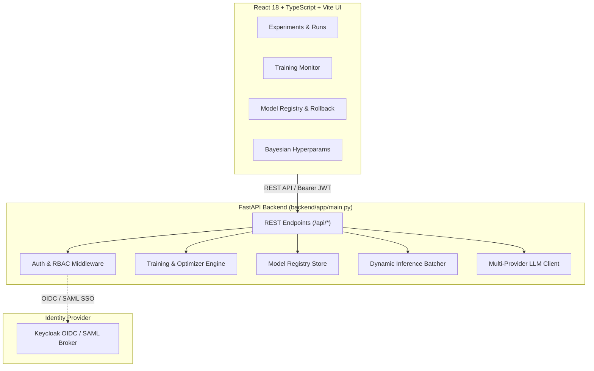

# AI ML Training Platform — Alan Vo | AI & Machine Learning

> Work in progress. This checkpoint may be incomplete or fail tests. See PLAN.md and STATUS.md before use.


Enterprise ML training platform with experiment tracking, model registry, Bayesian hyperparameter optimization, LLM-powered architecture suggestions, and real-time training monitoring. It addresses the end-to-end machine learning engineering workflow for AI researchers, ML platform engineers, and data scientists.

## Architecture



## Quick Start

```bash
git clone https://github.com/ALANDVO/ai-ml-platform-alan-vo.git
cd ai-ml-platform-alan-vo
cp .env.example .env

# Run locally:
python3 -m venv .venv
source .venv/bin/activate
pip install -r backend/requirements.txt
PYTHONPATH=backend pytest backend/tests

cd frontend
npm ci
npm run build
npm test
```

## AI & Machine Learning Evaluation

The platform includes deterministic optimization algorithms (SGD, Adam, Bayesian acquisition) alongside simulated training convergence routines.

### Reproducible Evaluation Command

To execute the offline evaluation suite verifying optimization convergence and metric curves:

```bash
PYTHONPATH=backend .venv/bin/pytest backend/tests/test_core.py -v
```

### Data Provenance & Baseline
- **Synthetic Quadratic Convex Optimization**: Baseline tracking optimizing $f(w) = (w - 3.0)^2$ from initial parameter $w_0 = 5.0$.
- **Baseline Metric**: Adam convergence achieves $|w - 3.0| < 0.2$ within 200 optimization steps at learning rate $\eta = 0.1$.
- **Hyperparameter Space Acquisition**: Evaluated across continuous learning rate intervals $[10^{-4}, 10^{-1}]$ and categorical optimizers (`adam`, `sgd`).
- **Failure Cases**: Highly non-convex surfaces with ill-conditioned gradients without momentum may exhibit slower convergence or saddle point stagnation.

## Provider Configuration

LLM features (architecture suggestions and experiment analysis) are provider-agnostic and advisory. Keys are strictly server-side:

| Variable | Required | Description | Default |
|---|---|---|---|
| `LLM_API_KEY` | Optional | API key for LLM suggestions | None |
| `LLM_PROVIDER` | Optional | Provider adapter (`openai`, `anthropic`, `gemini`, `ollama`) | `openai` |
| `LLM_BASE_URL` | Optional | Base endpoint URL for provider | `https://api.openai.com/v1` |
| `LLM_MODEL` | Optional | Model identifier to request | `gpt-4o` |

## API Reference

| Method | Endpoint | Description |
|---|---|---|
| `POST` | `/api/auth/login` | SAML/SSO login or email login |
| `GET` | `/api/auth/me` | Get current user |
| `GET` | `/api/health` | Health check |
| `GET` | `/api/experiments` | List experiments |
| `POST` | `/api/experiments` | Create experiment |
| `GET` | `/api/experiments/{id}/runs` | Runs for an experiment |
| `GET` | `/api/runs/{id}` | Run details with metrics |
| `POST` | `/api/runs/{id}/stop` | Stop a running training run |
| `GET` | `/api/runs/{id}/metrics` | Metric curves for charting |
| `GET` | `/api/models` | Model registry |
| `POST` | `/api/models` | Register a model |
| `GET` | `/api/models/{id}/versions` | Version lineage |
| `POST` | `/api/models/{id}/rollback` | Roll back to a version |
| `POST` | `/api/models/compare` | A/B compare two model versions |
| `GET` | `/api/hyperparams/spaces` | Search spaces |
| `POST` | `/api/hyperparams/optimize` | Start Bayesian optimization |
| `GET` | `/api/hyperparams/optimize/{id}` | Optimization status |
| `POST` | `/api/llm/architecture` | LLM architecture suggestions |
| `POST` | `/api/llm/analyze` | LLM experiment analysis |
| `GET` | `/api/training/active` | Active training jobs |
| `GET` | `/api/inference/predict` | Served inference with batching |

## SSO / SAML Setup

1. Register the application in Keycloak or upstream SAML Identity Provider (Okta, ADFS, OneLogin) as a Service Provider.
2. Configure settings in `.env`:
   - `SAML_IDP_ENTITY` — IdP entity ID
   - `SAML_IDP_CERT` — Base64 IdP signing certificate
   - `SAML_SP_ENTITY` — SP entity ID (`https://yourdomain.com/saml/sp`)
   - `SAML_ACS_URL` — Assertion Consumer Service URL
3. Map role assertions to: `admin` (full access), `ml_engineer` (training and registry mutations), `viewer` (read-only inspection).
4. Unauthenticated requests are rejected with HTTP 401; unauthorized operations with HTTP 403.

## Docker Deployment

```bash
docker compose up -d          # build + run backend, frontend, and Keycloak
docker compose logs -f backend # follow backend logs
docker compose down           # stop
```

Production deployment requires running behind a TLS reverse proxy with persistent volume mounts for data storage and checkpoints.

---

**Built by [Alan Vo](https://github.com/ALANDVO)** | alanvo@gmail.com | AI & Machine Learning
